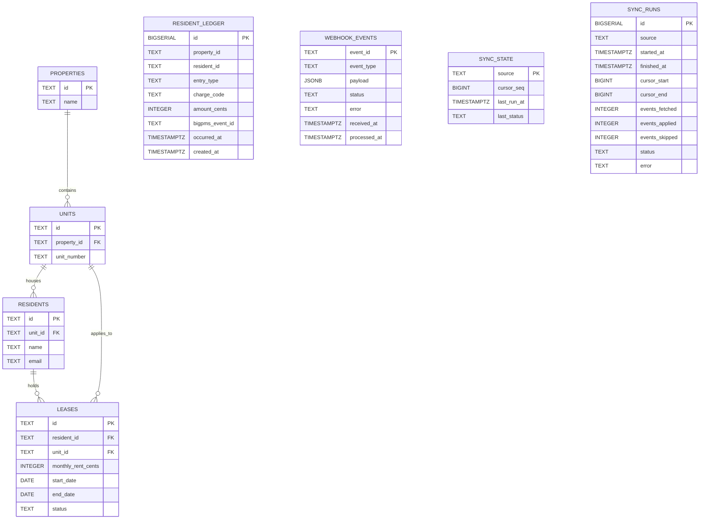

# Local Database Entity Relationship Diagram

Only declared foreign keys are shown as relationships. `resident_ledger` intentionally has no foreign keys, so orphaned entries are representable; its `property_id` and `resident_id` are not constrained to other tables. The webhook and sync audit/state tables are also standalone in the provided schema.

## Entities and likely uses

| Entity | Likely use |
|---|---|
| `properties` | Represents a managed property and anchors its units. |
| `units` | Represents rentable units within a property; residents and leases reference units. |
| `residents` | Stores resident identity and contact details, associated with a unit. |
| `leases` | Stores a resident's lease term, status, and monthly rent amount. |
| `resident_ledger` | Local financial history of charges and payments; supports balances, payment reconciliation, and data-quality checks. |
| `webhook_events` | Audit trail for every inbound BigPMS webhook, including processed, duplicate, or failed deliveries. |
| `sync_state` | Stores the feed sync cursor and latest run status so scheduled sync can resume from durable progress. |
| `sync_runs` | Records each feed sync attempt, its cursor range, event counts, status, and any error. |
