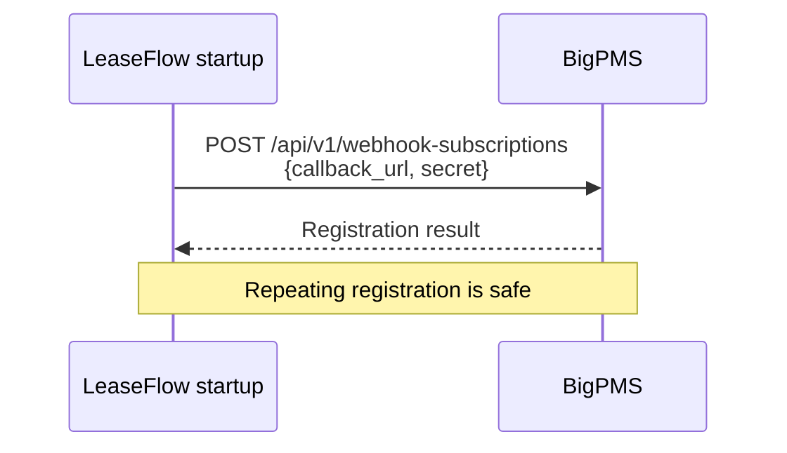
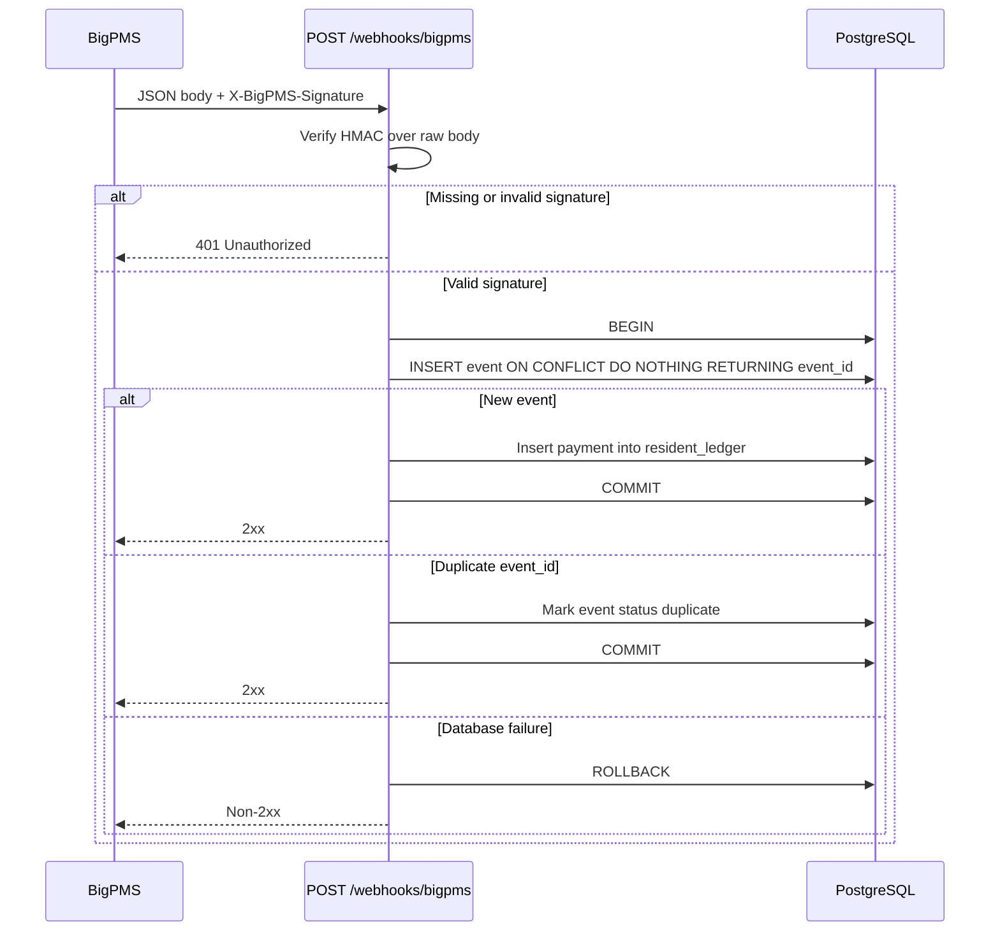

# BigPMS Webhook Callback Spec

## Scope

Implement TODO 1 in `app/main.py`: register the BigPMS webhook subscription at app startup and process `payment.received` callbacks at `POST /webhooks/bigpms`. Feed sync and reconciliation are out of scope.

## Startup registration

Send `POST {BIGPMS_API_URL}/api/v1/webhook-subscriptions` with `CALLBACK_URL` and `WEBHOOK_SECRET`. Registration is idempotent and safe on every startup. Treat partner errors as startup/registration failures; do not report success when the subscription was not confirmed.

## Callback contract

- Accept the BigPMS JSON event payload; retain the exact raw request bytes for signature validation.
- Verify `X-BigPMS-Signature` as the hex HMAC-SHA256 of the raw body using `WEBHOOK_SECRET`. Compare signatures using a constant-time comparison. Reject a missing or invalid signature with **401** and do not post a payment.
- For a valid `payment.received` event, write the event audit row and payment ledger row in one database transaction. Any failure rolls back both.
- Ledger row fields: `entry_type='payment'`, event resident, positive `amount_cents`, event ID, and `occurred_at`. Set required `property_id` to `prop-001` (single-property scope).
- Deduplicate by BigPMS `event_id`, including concurrent deliveries. Use `INSERT ... ON CONFLICT DO NOTHING RETURNING` on `webhook_events.event_id` as the processing claim: only the transaction that inserts the event row may insert the ledger payment. If no row is returned, update the existing event status to `duplicate` and return 2xx without inserting a payment.
- A successfully applied event is recorded as `processed`. Use `failed` for a recorded processing failure when possible; roll back the audit and ledger writes together if either fails.
- Do not acknowledge successful processing until the transaction commits. Database/processing failures must surface as non-2xx so BigPMS can retry.

The schema allows only one `webhook_events` row per `event_id`. Therefore a redelivery is represented by updating that event's status to `duplicate`, not by appending another row. Invalid signatures must never create a ledger payment.

## Out of scope: operational enhancements

- **Callback-rate monitoring:** track received and successfully processed callbacks over time; alert on an unexpected drop or sustained absence.
- **Automatic subscription recovery:** detect a missing or inactive BigPMS subscription and retry registration with bounded backoff, logging each attempt and outcome.

These are useful production capabilities, but are not required for this implementation.

## Acceptance checks

1. Startup registers the configured callback and secret; restarting does not create multiple subscriptions.
2. A valid event creates one `processed` audit row and one matching payment ledger row.
3. Invalid signatures return 401 and never post a payment.
4. Replaying the same event ID, including concurrent requests, returns 2xx without increasing the payment total; its audit status is `duplicate`.
5. A failure during either database write leaves no partial audit/payment pair and returns non-2xx.
